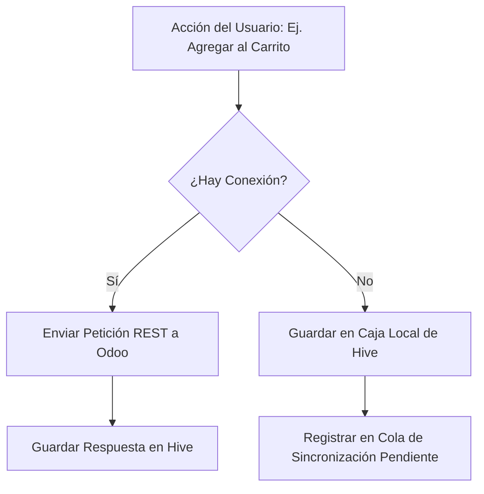

# DATABASE.md - Persistencia Offline-First & Almacenamiento Local (Hive)

Este documento detalla el diseño de almacenamiento local, los modelos de caché, las políticas de sincronización y las relaciones de bases de datos implementadas en TStore utilizando **Hive**.

---

## 1. Diseño de Cajas (Boxes) de Hive

Para lograr un funcionamiento rápido y un consumo de memoria mínimo con catálogos extensos, dividimos la información en cajas específicas y persistentes de Hive:

| Nombre de la Caja | Clave del Almacén | Contenido | Estructura de Datos |
| :--- | :--- | :--- | :--- |
| `products_cache_box` | `[id]` (int) | Catálogo de productos y detalles individuales. | `Map<String, dynamic>` (JSON) |
| `categories_cache_box` | `categories_tree_cache` | Jerarquía de categorías. | `List<Map<String, dynamic>>` (JSON) |
| `cart_local_box` | `[product_id]` (int) | Artículos guardados en el carrito de compras. | `Map<String, dynamic>` (JSON) |
| `cart_local_box` (Especial) | `cart_pending_sync_queue` | Cola de operaciones del carrito pendientes de envío. | `List<Map<String, dynamic>>` |
| `favorites_local_box` | `favorites_ids_list` | Lista de IDs de productos marcados como favoritos. | `List<int>` |
| `favorites_local_box` (Especial)| `favorites_pending_sync_queue` | Cola de favoritos agregados/quitados sin internet. | `List<Map<String, dynamic>>` |
| `orders_cache_box` | `orders_cache_list` | Historial de pedidos y detalles de venta. | `List<Map<String, dynamic>>` |
| `app_config_box` | Variables varias | Datos de configuración general e-commerce. | `Map<String, dynamic>` |

---

## 2. Modelos de Datos & Serialización

Dado que Hive almacena colecciones Dart primitivas listas para usar, evitamos la necesidad de compilar TypeAdapters nativos mediante la serialización a mapas JSON. Esto ofrece los siguientes beneficios:
1. **Estabilidad:** No hay riesgos de fallos de inicialización debido a cambios en los esquemas binarios entre versiones de la app.
2. **Facilidad de Mocking:** Los datos guardados de forma local coinciden exactamente con las respuestas HTTP de Odoo.
3. **Conversión Automática:** Los modelos (`UserModel`, `ProductModel`, `CategoryModel`, `CartItemModel`, `OrderModel`) implementan métodos `fromJson` y `toJson` para realizar el mapeo de tipos de forma instantánea.

---

## 3. Estrategia de Sincronización Fuera de Línea

Cuando un usuario interactúa con la aplicación, la aplicación valida el estado de la conexión a internet mediante `ConnectivityService`:



### Cola de Sincronización (Offline Sync Queue)
Cualquier acción de modificación (agregar, editar cantidad, eliminar artículo, o cambiar favoritos) efectuada sin conexión, agrega un registro de auditoría en la cola `cart_pending_sync_queue` o `favorites_pending_sync_queue`.

Ejemplo de estructura de cola:
```json
[
  {
    "product_id": 101,
    "quantity": 2,
    "action": "add",
    "timestamp": "2026-07-19T23:45:00Z"
  },
  {
    "product_id": 102,
    "action": "remove",
    "timestamp": "2026-07-19T23:45:10Z"
  }
]
```

### Proceso de Sincronización (Sync)
Cuando se restablece la conexión (o el usuario solicita una sincronización manual en el perfil):
1. El sistema lee los ítems de la cola de forma secuencial.
2. Llama a los endpoints remotos `/api/cart/add`, `/api/cart/update`, o `/api/cart/remove` para aplicar los cambios correspondientes en la sesión de Odoo.
3. Una vez confirmada la sincronización exitosa de todos los elementos, limpia la cola de transacciones locales y solicita el carrito actualizado oficial de Odoo.

---

## 4. Políticas de Caché e Invalidadación

* **Productos y Categorías:** Se leen directamente de Hive para dar carga instantánea y funcionamiento fuera de línea. Si la conexión está activa, se refresca el caché en segundo plano de forma silenciosa para mantener actualizados los precios y niveles de stock.
* **Carrito y Favoritos:** Prevalece el almacenamiento local inmediato para no obstaculizar la experiencia de compra del usuario final, realizando la sincronización remota de forma asíncrona.
* **Invalidadación manual:** Al cerrar sesión, la aplicación ejecuta la limpieza completa de todas las cajas confidenciales (`cartBox`, `favoritesBox`, `ordersBox`) por cuestiones de seguridad.
